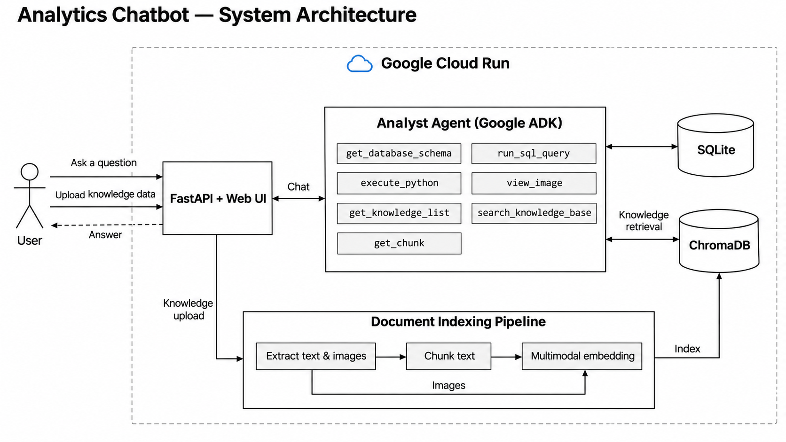
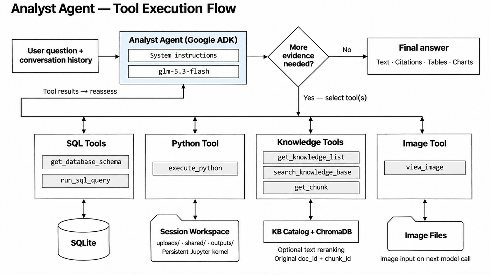
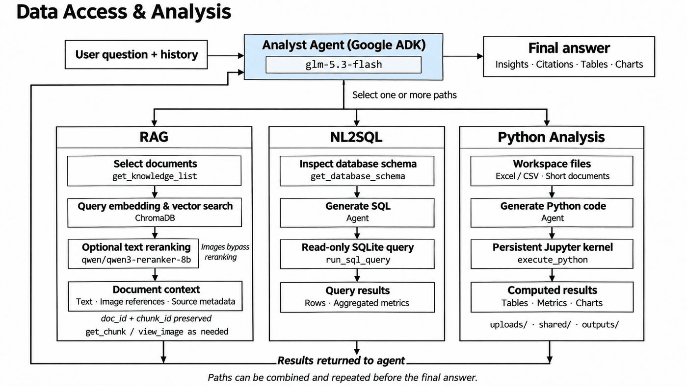
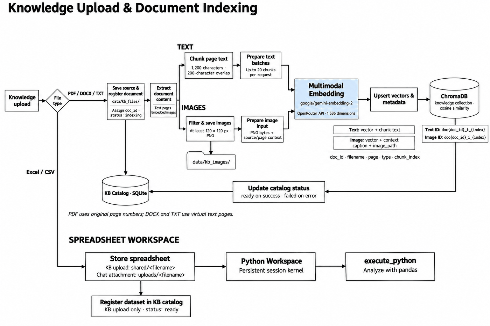

# Analytics Chatbot

[Live Demo](https://neura-analytics-chatbot-1098550132960.asia-southeast2.run.app)

Analytics Chatbot combines operational SQL analysis, spreadsheet processing, and multimodal document retrieval through a single Google ADK agent. FastAPI serves the web interface and streams answers and tool events to the browser.

## System Overview

Users can ask questions or upload knowledge data. The application runs on Google Cloud Run; model inference, embeddings, and optional reranking use OpenRouter APIs.



SQLite stores operational data, conversation state, and the knowledge catalog. ChromaDB stores document embeddings. Uploaded files, extracted images, and generated outputs remain on the application filesystem. The current Cloud Run configuration does not provide persistent external storage.

## Agent Execution

The **Analyst** agent uses `glm-5.3-flash` with system instructions and conversation history. It selects tools as needed, evaluates their results, and repeats until it can produce an answer. Tools are independent capabilities, not a fixed execution sequence.



| Capability | Tools |
|---|---|
| Read-only SQL analysis | `get_database_schema`, `run_sql_query` |
| Persistent Python analysis | `execute_python` |
| Knowledge retrieval | `get_knowledge_list`, `search_knowledge_base`, `get_chunk` |
| Visual inspection | `view_image` |

Image inspection injects image content into the next model request. Answers can include tables, document citations, and generated charts.

## Data Access and Analysis

The agent combines three paths: RAG retrieves document context, NL2SQL queries operational data, and Python analyzes workspace files. Each path returns results to the agent and can be repeated before the final answer.



RAG search respects document visibility, readiness, and enabled status. With `RERANK_ENABLED=true`, text candidates are reranked by `qwen/qwen3-reranker-8b`; image candidates retain embedding-based ranking. API failures or timeouts fall back to vector ordering.

Results preserve the original `doc_id` and `chunk_id`, allowing `get_chunk` to retrieve neighboring text. Disabling reranking restores the original combined vector search. Environment changes require a server restart.

## Knowledge Upload and Indexing

Document ingestion extracts text and embedded images, chunks the text, and embeds both content types using `google/gemini-embedding-2`. Text and image entries share one ChromaDB collection while retaining separate identities and source metadata.



Excel and CSV files bypass vector indexing. Chat attachments are stored in the session workspace; knowledge-base datasets are shared across sessions and registered in the catalog. The agent analyzes them through Python when needed. Short documents uploaded in chat also bypass indexing; knowledge-base documents and larger chat documents follow the indexing pipeline.

## Quick Start

Use Python 3.12 or later. The repository includes sample files and prebuilt knowledge data; regeneration is optional.

```bash
python3 -m venv .venv
source .venv/bin/activate
pip install -r requirements.txt
cp .env.example .env
```

Set `OPENROUTER_API_KEY` in `.env`, then start the application:

```bash
uvicorn app.server:app --reload --port 8000
```

Open http://127.0.0.1:8000. Process environment variables take precedence over the parent workspace `.env`, followed by the project `.env`.

## Configuration

```dotenv
RERANK_ENABLED=true
RERANK_MODEL=qwen/qwen3-reranker-8b
RERANK_TIMEOUT_SECONDS=8
RERANK_TEXT_CANDIDATES=20
RERANK_IMAGE_TOP_K=2
RERANK_FINAL_TOP_K=6
```

See [.env.example](.env.example) for settings. Restart the server after configuration changes. With reranking enabled, retrieval selects up to six results, including at most two images. Reranking failures retain vector-ranked text results.

## Validation and Deployment

Run the local tests:

```bash
python -m unittest discover -s tests -v
```

HTTP simulation tests require the optional Postman simulation described in [its configuration](postman/simulations/rerank/rerank.sim.yaml).

To deploy, review the project and region in [deploy_cloud_run.sh](deploy_cloud_run.sh), authenticate with Google Cloud, and run:

```bash
bash deploy_cloud_run.sh
```

The script builds and deploys the application with its configured environment variables. The bundled application-state database retains the knowledge catalog without local conversation history. Session workspaces, secrets, and local environments are excluded from Git.
